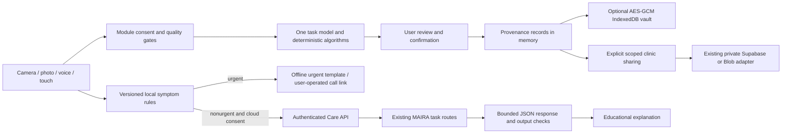

# Everyday companion architecture

The existing buildless HTML/ES-module app is preserved at `/` and `/app`. The additive workspace is `/everyday.html`. It uses the same MediaPipe assets, browser speech infrastructure, MAIRA provider and private server store. No framework, database, auth provider or trained checkpoint was added.

`contracts.js` defines the JSDoc evidence contract and runtime validation. `EvidenceStore` owns local saving consent, encryption, retention and deletion. `CameraManager` owns a single stream/model and cancels late startup on navigation, backgrounding or model failure. `ModelManager` validates weight bytes before the existing MediaPipe runtime loads them; it tries GPU then CPU/WASM. WebGPU is detected as a device capability, not claimed as a separately implemented runtime.

Nutrition uses attributed ingredient records and deterministic gram arithmetic. Move uses aspect-correct camera-plane joint geometry, One Euro filtering and complete-cycle state machines. EyeSpeak fits personal iris/head regression, then requires held-out target checks before dwell selection. Care evaluates local rules before cloud authorization or generation. The existing assistive app retains its own established camera lifecycle; leaving it for Everyday is full navigation, and Everyday stops its camera before any module transition.

`/api/clinic` uses random capability credentials, hashed at rest, tenant-prefixed keys, server-enforced roles, per-patient sharing grants and audited actions. This is a demo access mechanism matching the existing private-link design, not identity verification or a clinical account system. Billing is a future tenant-scoped concern; no payment integration exists.

The local preview routes new Clinic requests to explicitly labelled in-memory storage. Production handlers reuse `server/common.js` and its existing private store. They were not deployed or migrated as part of this change. Care's live provider requires the existing server MAIRA credentials and session store; an unavailable provider falls back to local educational guidance. No private key appears in a client bundle.
