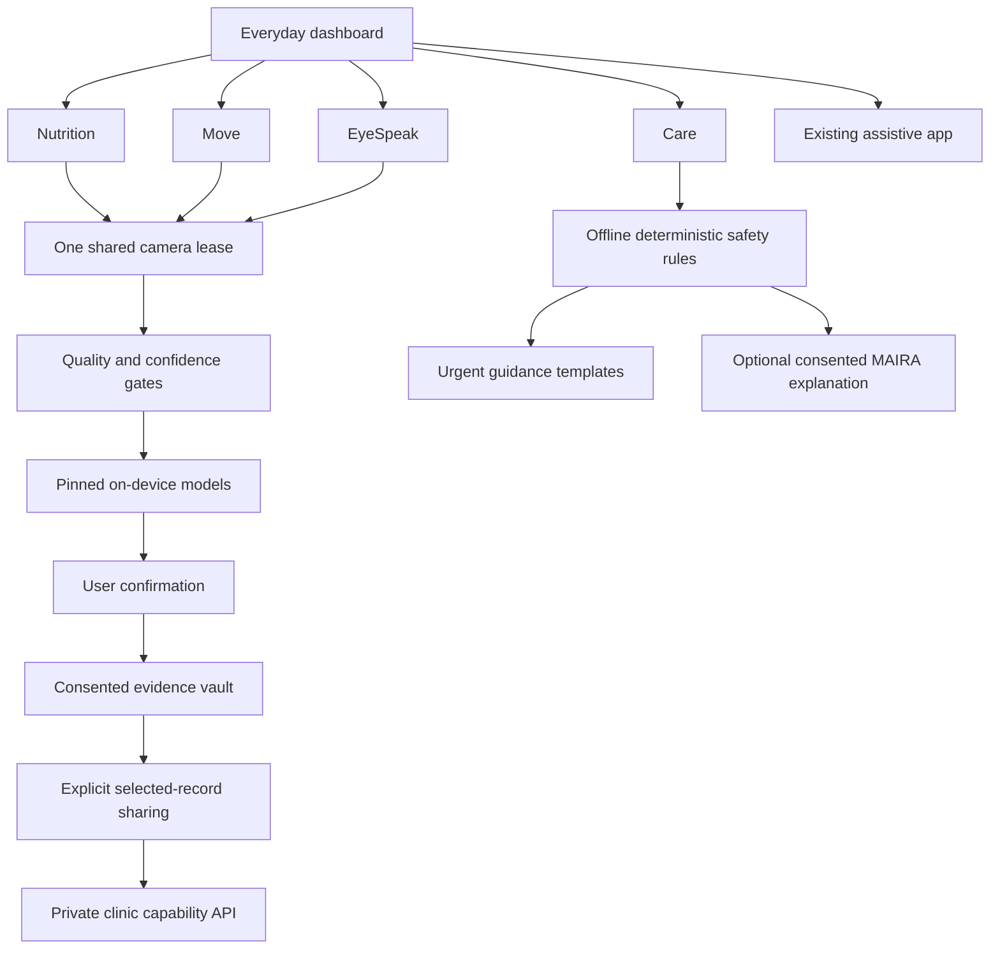

# ASHA Everyday implementation plan

Date: 2026-11-10. Branch: `codex/asha-everyday-companion`. Baseline: `a145b2c`.

## Current-state audit

The working application is buildless JavaScript ES modules, HTML and CSS. Vercel runs Node.js handlers in `api/`. `server/common.js` selects the existing private Supabase key/value table when configured, otherwise Vercel Blob. Hashed patient/caregiver capability tokens authorize existing care circles. This is distinct from account-based clinic identity.

The installed models are MediaPipe Face, Hand and Pose Lite, TensorFlow.js patient-trained FingerSpeak BiGRU, and optional YOLO26n-pose through ONNX Runtime Web. Existing source/asset hashes and notices are in `models/` and `neuroface/vendor/`. There are 163 original unit tests plus Playwright camera and delivery checks. The initial worktree run exposed a generated OKF source-text parity failure caused by Windows checkout line endings. That will be repaired through deterministic regeneration, with the actual result recorded.

`app/main.js` owns the assistive flow, shared perception, guided calibration, spoken check-ins and confirmed caregiver requests. `app.html` and `index.html` are matching entry points. The separate commercial website lives in `website/`. The unfinished `nextjs-migration` branch is excluded from this implementation because its UI wiring has known compatibility gaps. Uncommitted website edits in the original checkout are retained there.

The supplied master prompt is the implementation specification. The supplied HTML blueprint is a design proposal. Model sizes in it are planning estimates, and clinical review is not supplied.

## Architecture

The everyday entry is additive and independently usable at `/everyday.html`. Root and assistive entry links lead to it without changing patient/caregiver URL semantics. Modules stop camera tracks on tab changes, hidden pages and disposal. One on-device model is active at a time in the everyday workspace.

## Reuse and new boundaries

- Reuse the bundled MediaPipe runtime and landmark assets, device TTS, original MAIRA provider, request authorization and private storage adapters.
- Add an everyday platform for shared camera leases, capability detection, model registry, quality checks, inference routing, consent, encrypted local evidence and opt-in aggregate timing telemetry.
- Keep new module engines DOM-free where practical, with JSDoc data contracts. Avoid a framework or database migration.
- Add clinic namespaces and role-scoped capability tokens. An organization invitation grants access to explicitly shared records. A clinician role is an access role, not verification of a professional qualification.
- Persist local health records only after consent. A passphrase unlocks an AES-GCM vault. Session-only operation remains available. Raw camera/microphone media is not retained by default.

## Dependency and model-license audit

| Component                                       | Decision                                                                                                                                                 |
| ----------------------------------------------- | -------------------------------------------------------------------------------------------------------------------------------------------------------- |
| MediaPipe runtime / pinned face and pose assets | Reuse existing assets, verify SHA-256, preserve Apache notices                                                                                           |
| TensorFlow.js / FingerSpeak                     | Preserve existing Apache-licensed runtime and personal training                                                                                          |
| Optional YOLO / ONNX Runtime                    | Preserve existing optional module. No new YOLO distribution. Document AGPL commercial review requirement                                                 |
| Nutrition                                       | Versioned attributed public food records and editable recipes. Food-trained classifier remains unavailable until licensed validated weights are supplied |
| Gaze                                            | Small local ridge regression over existing face/iris landmarks. No additional checkpoint                                                                 |
| Whisper / offline LLM                           | Download adapter only after a signed approved pack exists. Do not bundle or pretend these models are installed                                           |
| Cloud AI                                        | Existing MAIRA adapter and secrets. No unrelated provider or framework migration                                                                         |

## Risk register and release boundaries

| Risk                                | Control and evidence needed                                                                                                                         |
| ----------------------------------- | --------------------------------------------------------------------------------------------------------------------------------------------------- |
| Unintended assistive requests       | Original state machines and separate confirmation remain intact; original regression suite                                                          |
| Food confusion / hidden ingredients | Manual confirmation, editable grams/oil/salt, assumptions and calorie ranges; weighed meal evaluation still required                                |
| Pose angle error / unsafe exercise  | Visibility gates, invalid-frame reset, placement guide, clinician-supplied rehab limits; independent angle reference required                       |
| Gaze drift / fatigue                | Personal calibration, held-out target check, adjustable dwell and undo, touch/switch alternatives; intended-user evaluation required                |
| Missed symptom warnings             | Deterministic bilingual rules precede cloud calls. Rules carry an unreviewed status until clinical review. No clinical deployment claim             |
| Cross-tenant access                 | Namespace every clinic resource; enforce token scope and patient grant server-side; rejection tests                                                 |
| Model corruption / supply chain     | Pinned hash verification, signature verification for downloadable releases, atomic activation and rollback; production release signing key required |
| Shared device / storage loss        | Consent, encrypted vault, lock/export/delete, retention and failure reporting                                                                       |
| Low RAM / poor network              | One model at a time, lazy imports, CPU fallback, no camera requirement for manual use, measured timing rather than asserted targets                 |

## Feature flags

Everyday manual nutrition, movement counters, AAC keyboard, journaling and local safety guidance can be enabled independently. Food vision requires verified food-trained weights. Cloud explanations require explicit consent and working MAIRA credentials. Offline ASR requires an approved signed multilingual pack. Clinical release requires review and validation. Signed production pack downloads require a configured public trust key. Clinic sharing requires the deployed clinic API and explicit patient grant.

## Migration and milestones

1. Audit and record regression baseline, establish contracts, provenance, safety and storage boundaries.
2. Add independent everyday dashboard, shared camera/model manager and privacy controls.
3. Implement Nutrition search/manual meal calculator, corrections, photo-quality check and honest model-unavailable state.
4. Implement four Move exercise counters, filtering, history, clinician-plan boundaries and tracking gates.
5. Implement EyeSpeak keyboard, calibrated gaze estimator, target validation, dwell/undo and fallbacks.
6. Implement Care structured intake, offline red-flag templates, consented context and optional existing MAIRA adapter.
7. Implement clinic roles/invitations, scoped sharing, plans and audit events. Run cross-tenant rejection tests.
8. Integrate end-to-end journeys, record actual asset sizes and timings, document missing external validation/assets and prepare a reviewable commit. Production publication requires explicit authorization.

## File-level ownership

| Files                                                                                                                                                                                                               | Work                                                                        |
| ------------------------------------------------------------------------------------------------------------------------------------------------------------------------------------------------------------------- | --------------------------------------------------------------------------- |
| `everyday.html`, `app/everyday/main.js`, `app/everyday/style.css`                                                                                                                                                   | Unified everyday navigation, common camera, module lifecycle and privacy UI |
| `app/everyday/platform.js`, `model-registry.js`, `contracts.js`                                                                                                                                                     | Camera/model orchestration, verified packs, capability/quality checks       |
| `app/everyday/evidence.js`                                                                                                                                                                                          | Encrypted local vault, consent, retention, export/delete                    |
| `app/everyday/nutrition.js`, `foods.js`                                                                                                                                                                             | Nutrition module and source records                                         |
| `app/everyday/move.js`, `move-engine.js`                                                                                                                                                                            | Exercise UI and deterministic counters                                      |
| `app/everyday/eyespeak.js`, `gaze-engine.js`                                                                                                                                                                        | AAC UI, calibrated mapping and dwell                                        |
| `app/everyday/care.js`, `safety.js`                                                                                                                                                                                 | Symptom journal, templates, local safety decisions and summaries            |
| `api/care.js`, `api/clinic.js`, `server/clinic.js`                                                                                                                                                                  | Cloud explanation gate and scoped clinic API                                |
| `index.html`, `app.html`, `sw.js`, `scripts/dev.mjs`                                                                                                                                                                | Additive entry, offline caching and local endpoint support                  |
| `tests/everyday-*.test.mjs`, `tests/everyday-browser.mjs`                                                                                                                                                           | New unit, security and browser regressions                                  |
| `docs/ARCHITECTURE.md`, `MODEL_REGISTRY.md`, `MODEL_BENCHMARKS.md`, `DATA_PRIVACY.md`, `CLINICAL_SAFETY_BOUNDARIES.md`, `VALIDATION_PLAN.md`, `FEATURE_FLAGS.md`, `DEPLOYMENT_NOTES.md`, `IMPLEMENTATION_STATUS.md` | Shipped scope, measurements, runbook and remaining gates                    |

## Acceptance tests

Retain the original suite. Test calorie units/corrections/provenance, complete versus incomplete repetitions, occlusion/gaps, ridge mapping and dwell rearm, ambiguous and negated bilingual symptom scenarios, safety before cloud, encrypted round-trip/incorrect passphrase, export/delete and retention, corrupt model hashes/signatures/rollback, stopped camera leases, consent withdrawal and clinic tenant/role isolation. Browser checks exercise the normal module entries and fallbacks. Actual low-end Android battery/thermal behavior and clinical/model accuracy remain unmeasured until appropriate devices, datasets and reviewers are available.
